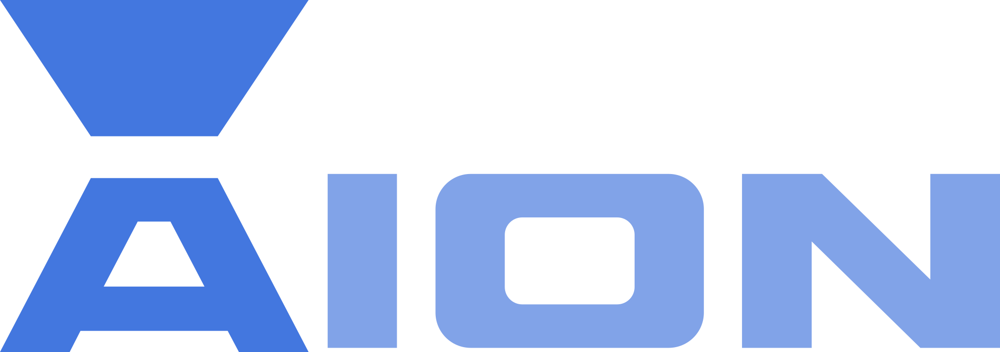

<div align="center">
  
</div>

<div align="center">

[](https://aionlang.github.io)
[](https://github.com/aionlang/aion)
[](https://astro.build)

</div>

## Aion Website & Documentation

Official website, language reference, standard library documentation, and binary downloads for the **[Aion programming language](https://github.com/aionlang/aion)** — a statically typed, garbage-collected language that reads like a script and compiles to a native binary through LLVM.

- **Live Website:** [https://aionlang.github.io](https://aionlang.github.io)
- **Documentation:** [https://aionlang.github.io/documentation](https://aionlang.github.io/documentation)
- **Downloads:** [https://aionlang.github.io/downloads](https://aionlang.github.io/downloads)
- **Compiler Repository:** [https://github.com/aionlang/aion](https://github.com/aionlang/aion)

## Local Development

```bash
npm install
npm run dev      # Start local dev server at http://localhost:4321
npm run build    # Build static site into ./dist
```
